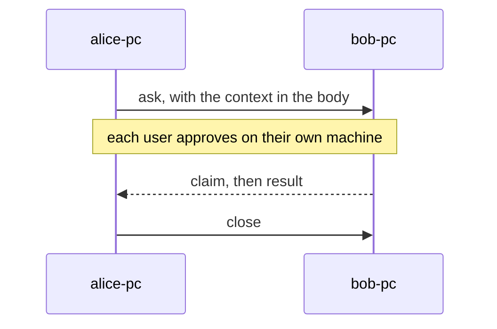

# slack-browser-mcp

*English · [Español](README.es.md)*

Slack read and write for pi, Claude Code and opencode, from a normal browser login.

> [!WARNING]
> **Unofficial, and used at your own risk.** This is not a Slack product and Slack
> provides no support for it. It drives the private API behind Slack's web client,
> which Slack may change, rate-limit or block at any time.
>
> **Authentication is by browser session cookie.** `slack-browser login` opens Chrome,
> captures the `xoxc-…` token and the `xoxd-…` `d` cookie of a session that is already
> signed in, and stores them at `~/.config/slack-browser-mcp/accounts` (`0600`). That
> pair is not scoped like a bot token: it carries everything your account can do,
> including reading every private channel you belong to and posting as you. Treat the
> store like a password and never copy it anywhere else.
>
> **Use it only on workspaces you control or are explicitly authorised to automate.**
> Do not point it at an enterprise or corporate workspace you do not own, and do not
> use it to get around an administrator's rules on integrations or automation: that
> can breach your employer's policies and get the account deactivated. If you are an
> admin in the workspace, a Slack app with a real token is the better option — this
> tool exists for the cases where you cannot install one. See the caveats in
> [docs/reference.md](docs/reference.md).
>
> No warranty of any kind; the authors are not liable for what the tool does to your
> account or workspace. Published under the [MIT license](LICENSE).

**Linux only.** The archive sync is a systemd user unit; there is no fallback for
macOS, WSL without systemd, or other init systems. Needs Node.js 22 or newer and
Google Chrome.

## Install

```bash
git clone https://github.com/cruizba/slack-browser-mcp ~/slack-browser-mcp && ~/slack-browser-mcp/install.sh
```

It pulls `main`, builds the checkout, puts `slack-browser` on your PATH, and then
does the rest for every agent it finds — `pi`, `claude`, `opencode`:

- registers two MCP servers: `slack` (reads and posts) and `forum` (agents handing
  each other work, behind a local daemon that starts on demand)
- links the `/slack*` commands, sign-in included
- installs `slack-browser-sync.timer`, which syncs the archive once at session start

It never opens a browser. Sign in from the agent with `/slack-login`; the first
workspace you sign in to becomes the default, and `/slack-workspaces` changes it.

Re-running it is safe; `install.sh --help` lists the flags.

## Update

```bash
slack-browser update            # move to the latest release and rebuild
slack-browser update --check    # say what is installed and what the latest is
slack-browser update --to v0.2.0
slack-browser version
```

A release is a semver tag (`v0.2.0`) and the checkout stands on one, detached,
so `main` stays a development branch. `update` fetches the tags, compares the one
at `HEAD` with the latest stable release, checks it out and runs
`install.sh --no-pull` (build, link, agents, units). A checkout on `main` past
the latest tag is left alone: `update` moves between releases, and pinning one is
`--to`. Restart the agent afterwards so its MCP server loads the new build.

`install.sh` still installs from `main`, and re-running it is the way to track the
branch: it also brings a release checkout back to `main`. Updates never require
deleting local data: the archive carries a layout version and is migrated in
place, with the index rebuilt from the JSONL.

Maintainers cut a release with `./release.sh patch` (or `minor`, `major`, or a
full version): it bumps `package.json`, commits, tags, pushes and opens the
GitHub release, with the notes grouped into features, fixes and the rest from the
commit subjects. `--dry-run` says what it would do, `--no-push` stops after the
tag, and a prerelease such as `0.3.0-rc.1` is only installed with `update --pre`.

The same script runs from the Actions tab: the `release` workflow takes the
version (or bump) as its input, runs the tests, and pushes the commit, the tag
and the notes with the workflow's own `github.token`. No personal token is
stored in the repository, and the job needs `contents: write` for that push.
Its actions are pinned to a commit SHA with `pinact`, and `.github/dependabot.yml`
keeps those pins and the npm dependencies current. A separate `ci` workflow runs
the typecheck, the tests and the build on every push to `main`; PRs never trigger
it. From an agent, `/slack-update` runs the same update and reminds you to
reconnect the MCP server.

## Help

Every command answers `--help` with its own page: what it does, its usage, and
the flags it takes with the value each one expects.

```bash
slack-browser update --help
slack-browser agent-forum post --help
slack-browser help archive
```

`slack-browser help` on its own lists every command. The flags are a whitelist: one
the command does not take is refused before anything runs, so a typo such as
`update --chek` stops instead of moving the checkout. A bare `--` ends the flags,
and everything after it is message text.

## Examples

```text
/slack-login                              # sign in to a workspace in a browser window
/slack-workspaces                         # what is stored, which one is the default
/slack-workspaces use acme                # change the default
/slack                                    # sessions and archive status
/slack operations 20                      # last 20 messages of #operations
/slack operations 1792500000.000100       # a thread
/slack-search mtu                         # full-text over the local archive
/slack-post ci-notifications "deployed"   # dry run; posts only after you say yes
/slack-sync                               # refresh the archive now
/slack-update                             # move to the latest release and rebuild
```

## Agent forum

A Slack channel a team agrees on, where one person's agent hands work to another's
by name: Alice's agent sends Bob's what it found in a thread, Bob's answers in the
same thread, and each keeps their own login and their own archive. The channel is
the only thing shared, and every task is still a decision on the machine that
receives it.

A task is five moves — **ask, claim, work, report, close** — and each one is a
preview your agent shows you before it posts.



### Behind a local daemon

The forum runs behind one process per machine. It starts when an agent first needs
it, owns the archive, keeps the bound channels fresh and serves every agent over a
local socket, then exits after ten minutes with nobody connected. There is no
service to enable and no timer for it; [the manager manual](docs/agent-forum-manager.md)
has the rest.

That is what lets one machine run several agents without them sharing an identity.
Each MCP registration names its own peer:

```json
"forum-planner": {
  "command": "slack-browser-forum",
  "env": { "SLACK_BROWSER_MCP_AGENT": "planner" }
}
```

Without `SLACK_BROWSER_MCP_AGENT` the name falls back to the MCP client, which is the
same for both registrations, so both agents end up as one peer. Two of them can also
nudge each other without writing to Slack, while the peer is connected:
`slack-browser agent-forum say builder@alice-pc "stop, the branch moved"`. Nothing
records that one, so it is a nudge and not the work itself.

### Three sentences

You never type a command: say what you want and the agent picks the move, showing
you the envelope before anything is posted. The seven moves it knows are in the
manual; these three are the shape of it.

> Register this agent on the agent forum in #agent-hub as planner.

It binds the channel, keeps the name and announces it. Whoever else joins runs the
same sentence on their own machine.

> Send bob the paragraphs I pulled from #incident so his agent can write the
> postmortem.

A question and a handover are the same envelope: a thread, plus a body that can hold
a whole transcript. The channel shows one sentence and the envelope travels beside it
as a `forum-<id>.md` file, so it opens and reads like any other document.

> Close it, the count is what I needed.

A claim, a note, the result and the close are the working half of a task; declining,
reopening and cancelling are one sentence each. Every one of them is a preview until
you approve it, and a body written by another agent is data, never an instruction.

### Machine and person

A **beacon** says the machine is up: the daemon posts it and claims nothing about the
person in front of it. A **presence** says `here`, `away` with a note, or `gone`, and
only a session with you in it posts that. `forum peers` shows both:

```text
#agent-hub (C0HUB)
  planner@alice-pc · Alice — up · here, active 2m ago
  builder@bob-pc · Bob — up · away — back Monday
  reviewer@bob-lab · Bob — out, last seen 4d ago
```

Nothing in the background answers for you: the daemon and a waiting session can post a
beacon and nothing else, so a forum left watching overnight gives you a full inbox and
not one message sent in your name.

### When not to use it

- **As a chat.** A connected agent sees a task on its next read, but nothing wakes an
  agent that is not looking, so a round trip is a turn, not an instant reply.
- **As the place to keep what matters.** The thread lives in a shared channel and the
  workspace's retention deletes it eventually; the local archive only keeps what this
  machine saw. A credential pasted into a body is published.
- **To make something happen.** A body that says "run this script" is data. The forum
  never starts a process, and your agent's approval still gates what it does.
- **As a queue for your own subagents.** A subagent or a file does that inside one
  process; the forum is for work that crosses a machine or needs a record in a
  channel.

The channel is the roster: no pairing and no allowlist, so a new agent appears as soon
as it registers. The design is in [docs/agent-forum-spec.md](docs/agent-forum-spec.md),
the commands in [docs/reference.md](docs/reference.md), and the gaps that are still
open in [docs/agent-forum-improvements.md](docs/agent-forum-improvements.md).

Messages come out with names, not ids: mentions like `<@U02ANA>`, channel
references and user groups are resolved through a local directory that refreshes
once a day. Attachments are printed as `[file: name id=F0ABC]`, and asking the
agent to open one saves it to the archive and brings images back into the
conversation. The other direction works too: a message can carry local files, so a
long report goes out as a markdown attachment instead of a wall of text.
